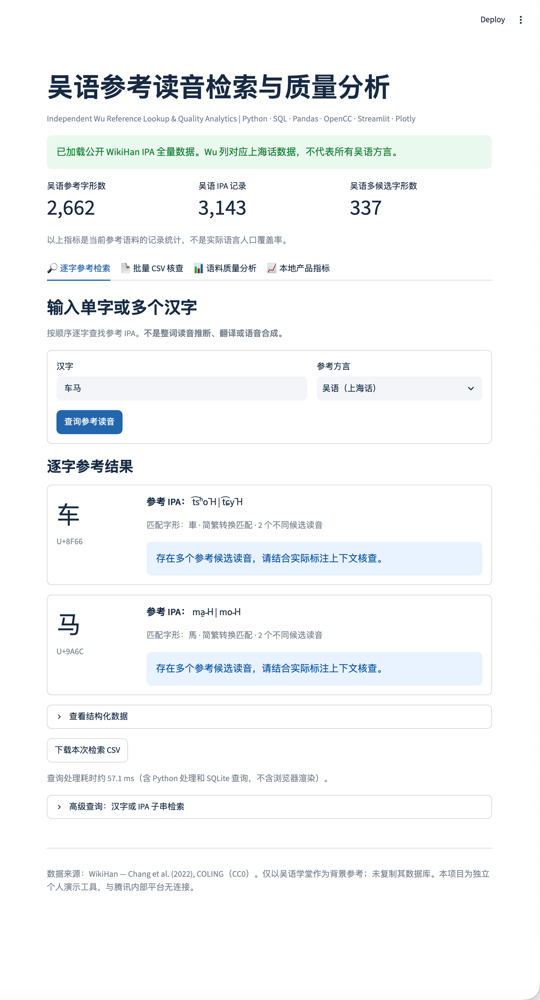
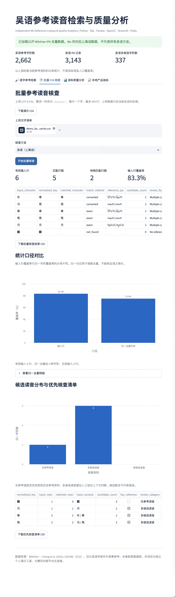
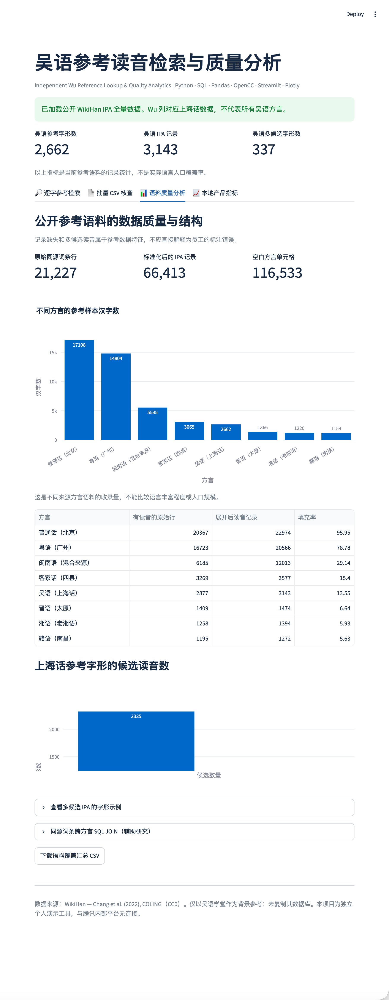
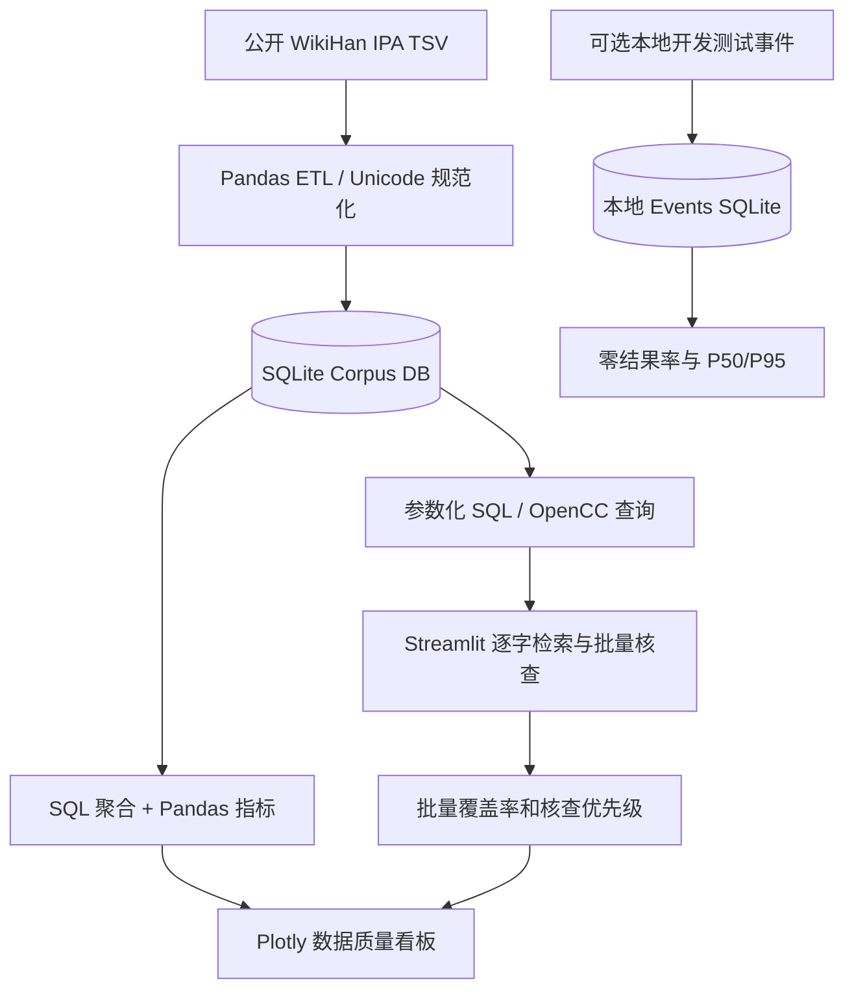

# 吴语参考读音检索与质量分析

**Wu Dialect Reference Lookup & Quality Analytics**

[](https://github.com/xinhaidi021005-sudo/Wu-Dialect-Reference-Analytics/actions)
[](LICENSE)

`Python` · `Pandas` · `SQLite / SQL` · `OpenCC` · `Streamlit` · `Plotly` · `pytest` · `GitHub Actions`

> **项目定位**：基于公开 WikiHan 语料独立开发的吴语参考读音检索与数据质量分析工具，为方言语料核查人员提供**逐字查询、批量参考核查和数据分析支持**。这不是员工标注平台，也不自动判定人工标注的对错。
>
> **独立开发与数据边界**：项目不连接腾讯或其他公司的内部系统；不使用企业私有语料、标注记录、员工数据或内部代码。所有演示均使用公开 WikiHan 数据或项目自带示例输入。

**English overview:** An independently developed pronunciation-reference lookup and corpus-quality analytics tool built on public WikiHan data. It combines searchable IPA references, batch CSV review, data cleaning, clearly defined coverage metrics, and interactive dashboards. It is not affiliated with or deployed by Tencent.

## 1. 项目背景与目标

方言语料核查工作可能需要反复查找汉字的参考读音、处理简繁体差异，并识别缺少参考值或存在多个候选读音的条目。单纯的人工逐字查询难以形成可复用的核查结果和统计分析。

本项目针对**辅助查询与参考数据质量分析**这一环节，建立以下流程：

1. 使用 Pandas 清洗公开 TSV 语料，规范化 IPA 数据并写入 SQLite。
2. 使用 OpenCC 和参数化 SQL 实现逐字检索与批量查询。
3. 对批量结果计算覆盖率、归一去重统计和候选读音分布，生成待人工核查清单。
4. 使用 Streamlit 和 Plotly 展示语料质量、方言参考记录及可选的本地开发测试指标。

## 2. 数据规模与主要发现

下表为本项目使用 **WikiHan 全量 IPA 文件**构建数据库后得到的统计结果。统计单位不同，不应混为同一种“覆盖率”。

| 指标 | 数值 | 口径说明 |
| --- | ---: | --- |
| 原始语料行数 | **21,227** | WikiHan TSV 的数据行（不含表头） |
| 标准化后 IPA 记录 | **66,413** | 对各方言多候选读音展开、清洗后的数据库记录 |
| 吴语参考字形数 | **2,662** | WikiHan `Wu` 列中具有参考读音的不同字形 |
| 吴语 IPA 记录数 | **3,143** | `Wu` 列清洗并展开后的读音记录 |
| 吴语多候选字形数 | **337** | 具有至少 2 种不同 IPA 的吴语参考字形 |
| 吴语来源行填充率 | **13.55%** | 2,877 / 21,227；表示该文件中 `Wu` 列有值的来源行比例 |

**主要分析结论：**

- **数据覆盖存在结构差异**：不同方言列的来源行填充率不同，反映的是当前参考数据的收录情况，**不代表方言的语言丰富程度、人口覆盖率或实际标注质量**。
- **多候选读音需要上下文判断**：337 个吴语字形存在多种参考 IPA。这是需要提示核查人员注意的情况，**不能直接归类为标注错误**。
- **指标分母会改变结论**：内置六行演示数据的原始输入行覆盖率为 **5/6 = 83.3%**，简繁归一后的不同检索键覆盖率为 **3/4 = 75.0%**。两个指标回答的问题不同，不能互相替代。

## 3. 核心功能与技术能力

| 功能模块 | 实现内容 | 对应技能 |
| --- | --- | --- |
| 🔎 逐字参考检索 | 单字/多字逐字查询、简繁转换、IPA 候选提示、CSV 下载 | OpenCC、参数化 SQL、数据库查询 |
| 📄 批量 CSV 核查 | 上传 `character` 字段的清单；匹配统计、无参考值提示、优先核查清单导出 | Pandas、数据清洗、批处理、规则设计 |
| 📊 语料质量分析 | 方言样本字形数、来源行填充率、多候选读音分布、跨方言来源行关联 | SQL 聚合/JOIN、Pandas、Plotly |
| 📈 本地产品指标（可选） | 开发测试搜索次数、零结果率、P50/P95 查询处理耗时 | 事件建模、指标定义、分位数分析 |
| ✅ 自动化验证 | 数据处理、查询、指标、安全规则的单元测试与 GitHub Actions | `pytest`、CI、可复现分析 |

**功能边界**：多字输入按顺序**逐字**查询，不推断整词发音；本项目不是翻译、语音合成或大模型问答系统。`Wu` 列在本数据集中对应上海话参考资料，不代表所有吴语方言。

## 4. 实际运行截图 / Screenshots

图片均来自本项目的本地 Streamlit 实际运行界面。点击图片或展开区域可查看完整细节。

### 4.1 逐字参考检索：简繁兼容与多候选 IPA

输入“车马”后，返回匹配字形“車”“馬”、对应参考 IPA 和多候选提示。

[](docs/screenshots/01_pronunciation_lookup.png)

<details>
<summary><strong>4.2 批量 CSV 核查：覆盖率与核查清单（点击展开）</strong></summary>

上传示例 CSV 后，展示有效输入行、匹配行数、简繁转换匹配、去重前后覆盖率、候选读音分布及可下载的优先核查清单。



</details>

<details>
<summary><strong>4.3 语料质量分析：公开 WikiHan 全量数据（点击展开）</strong></summary>

展示原始语料、清洗后 IPA 记录、不同方言参考字形数量、来源行填充率及吴语候选读音分布。



</details>

## 5. 核心指标与统计口径

| 指标 | 计算方法 | 用途 |
| --- | --- | --- |
| 输入行覆盖率 | 成功匹配的有效输入行数 / 有效输入行数 | 衡量一批输入任务行能够获取参考值的比例 |
| 归一字形覆盖率 | 匹配的归一检索键数 / 全部不同归一检索键数 | 避免简繁混合与重复输入影响字形维度统计 |
| 转换匹配行数 | 通过简繁转换后找到参考读音的输入行数 | 衡量字形转换在当前批次中的匹配贡献 |
| 多候选字形数 | 具有至少两种不同参考 IPA 的字形数量 | 提示可能需要结合上下文人工判断的条目 |
| 方言来源行填充率 | 在该方言列有读音的来源行数 / 有效语料来源行数 | 衡量本数据集不同方言列的资料完整情况 |
| 零结果率（本地测试） | 返回零结果的搜索事件数 / 搜索事件总数 | 排查开发测试中的检索问题 |
| P50 / P95（本地测试） | 服务器端查询处理耗时的第 50 / 95 百分位数 | 观察本地查询过程的耗时分布 |

**注意**：简繁转换有一简对多繁、语境依赖等限制，归一化检索键不一定代表语义等价；没有参考值不意味着该字在现实中没有读音。查询处理耗时不含浏览器渲染与网络传输，少量本地测试不能用于宣称真实线上性能。

## 6. 技术架构



项目模块化组织：`src/etl.py` 负责数据入库，`src/lookup.py` 提供逐字和批量共用的查询逻辑，`src/metrics.py` 计算指标与核查清单，`src/analytics.py` 负责 SQL 分析，`app.py` 负责页面展示。

## 7. 项目结构

```text
Wu-Dialect-Reference-Analytics/
├── app.py                        # Streamlit 网页入口
├── src/
│   ├── etl.py                    # TSV 清洗与 SQLite 建库
│   ├── lookup.py                 # 逐字/批量共用检索逻辑
│   ├── metrics.py                # 覆盖率、去重、核查优先级
│   ├── analytics.py              # SQL 查询与语料汇总
│   ├── events.py                 # 可选的本地测试事件
│   └── config.py
├── scripts/
│   ├── fetch_wikihan.py         # 获取公开全量 TSV
│   ├── build_database.py        # 构建本地语料库
│   └── generate_report.py       # 导出可复现分析报表
├── sql/
│   └── analysis_queries.sql
├── data/
│   ├── sample_wikihan.tsv       # 仓库自带 CC0 公开小样本
│   ├── demo_batch_queries.csv   # 批量查询演示输入
│   └── DATA_SOURCE.md
├── docs/
│   ├── screenshots/
│   │   ├── 01_pronunciation_lookup.png
│   │   ├── 02_batch_audit.png
│   │   └── 03_quality_dashboard.png
│   └── PORTFOLIO_AND_PRIVACY.md
├── tests/                        # pytest 测试
├── .github/workflows/ci.yml     # GitHub Actions CI
├── requirements.txt
├── requirements-dev.txt
├── .gitignore
└── LICENSE
```

## 8. 安装与运行 / Quick Start

推荐 Python 3.13；以下为 macOS 终端示例。

```bash
git clone https://github.com/xinhaidi021005-sudo/Wu-Dialect-Reference-Analytics.git
cd Wu-Dialect-Reference-Analytics

python3 -m venv .venv
source .venv/bin/activate
python -m pip install -r requirements.txt

python -m streamlit run app.py
```

启动后打开 **http://localhost:8501**。首次运行会使用仓库内的公开小样本自动建立本地 SQLite 数据库。

### 使用 WikiHan 全量公开语料

在项目根目录执行：

```bash
python scripts/fetch_wikihan.py
python scripts/build_database.py
python scripts/generate_report.py
```

如果 macOS 的 Python 出现 `SSL: CERTIFICATE_VERIFY_FAILED`，可改用系统 `curl` 下载**官方公开源文件**：

```bash
curl -fL --retry 3 \
  "https://raw.githubusercontent.com/cmu-llab/wikihan/main/wikihan-ipa.tsv" \
  -o data/wikihan-ipa.tsv

python scripts/build_database.py
python scripts/generate_report.py
```

然后刷新网页。生成的数据库位于 `data/processed/`，导出的汇总报表位于 `reports/tables/`。这些**本地产物不会提交到 GitHub**，其他人可以用相同的公开源文件自行复现。

### 批量 CSV 格式

上传的 UTF-8 CSV 应包含一列名为 `character`，每行一个汉字，单次最多 500 行。可以直接使用仓库里的 `data/demo_batch_queries.csv` 体验完整流程。

## 9. 自动化测试 / Testing

```bash
python -m pip install -r requirements-dev.txt
python -m pytest -q
```

项目包含 GitHub Actions 测试工作流，代码提交后可在仓库 **Actions → Tests** 查看运行结果。测试成功表示已定义的检查项通过，不等同于生产环境部署验收。

## 10. 数据来源、隐私与使用限制

- **公开数据**：[WikiHan](https://github.com/cmu-llab/wikihan)，论文见 Chang et al. (2022), *WikiHan: A New Comparative Dataset for Chinese Languages*（COLING）；所用上游数据采用 **CC0**。
- **本项目代码**：采用 [MIT License](LICENSE)。原始公开数据的授权与本项目代码授权分别适用。
- **参考网站**：[吴语学堂](https://www.wugniu.com/) 仅用于背景参考；本项目**未爬取、镜像或复制**该网站的数据库。
- **公司数据隔离**：不包含或连接腾讯内部标注平台、企业语料、员工信息或私有代码；它是独立个人作品，并未宣称在腾讯内部上线。
- **上传数据**：批量 CSV 在本地运行中的 Streamlit 会话内处理，不作为事件原文写入本地日志；如使用公开云端部署，请不要上传企业保密或个人敏感数据。
- **本地开发测试埋点**：默认关闭。如通过 `ENABLE_LOCAL_ANALYTICS=1` 启动，仅采集开发测试所需的随机会话标识、事件类型、长度/数量和处理耗时等字段，不记录查询原文或上传文件内容。随机会话 ID 属于**假名标识**，并不等于完全匿名。

详细的个人项目与实习经历边界说明见 [Portfolio & Privacy](docs/PORTFOLIO_AND_PRIVACY.md)。

---

**项目用途**：展示公开语料 ETL、SQL 查询与分析、Pandas 数据清洗、指标设计、Plotly 可视化、轻量数据产品开发及自动化测试能力。**所有结果应结合数据源和分母解释，不用于自动判定人工标注质量。**
